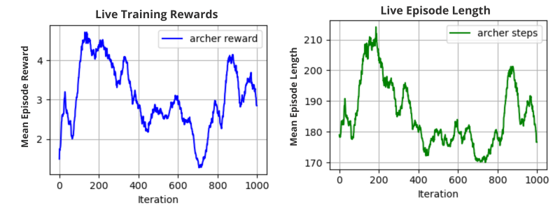
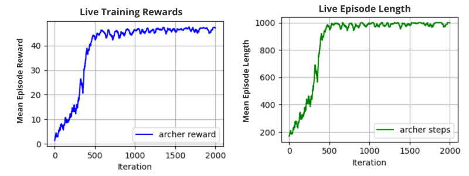
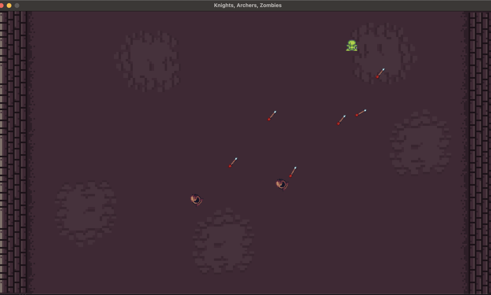
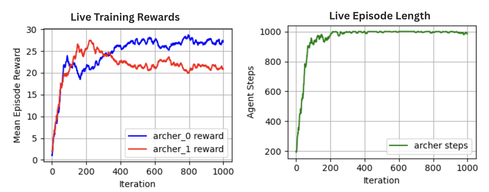

# Multi-Agent Reinforcement Learning with PPO

Reinforcement Learning project using the **Knights, Archers, Zombies
(KAZ)** environment from
[PettingZoo](https://pettingzoo.farama.org/environments/butterfly/knights_archers_zombies/).
The project explores Proximal policy optimization (PPO) training, observation engineering,
hyperparameter tuning, and cooperative multi-agent behaviour.

## Approach

### Single-agent PPO

Baseline Proximal Policy Optimization (PPO) configuration.

Then, the model was improved through:

-   Increasing the batch size from 512 to 4,000 and the number of
    training epochs from 1 to 10.
-   Tuning Generalized Advantage Estimation (GAE) lambda to 0.95 and the
    PPO clipping parameter to 0.2.
-   Adding custom observation features based on the angle differences
    between the archer's aiming direction and zombie positions.
-   Applying a dynamic learning rate, decreasing from 3e-4 to 1e-6
    over 2,000 iterations.

The average test reward increased from **2.46** with the initial PPO
setup to **48.01** with the fine-tuned configuration (18.5x improvement).

### Cooperative multi-agent PPO

The agents used centralised training and learned coordinated
behaviour through indirect communication, observing the other
agents' states rather than exchanging explicit messages.

The learned policy distributed coverage across the game field, with
archers tending to position themselves on opposite sides. The
multi-agent configuration used a batch size of 8,000, 15 SGD iterations,
and a dynamic learning rate from 3e-4 to 1e-6.

The multi-agent experiment achieved an average reward of **48.63**.

## Technologies

-   Python
-   PettingZoo (Knights, Archers, Zombies environment)
-   Proximal Policy Optimization (PPO)
-   Reinforcement Learning and Multi-Agent Reinforcement Learning

## Notes

Further analysis are explained in [project-report.pdf](./project-report.pdf)